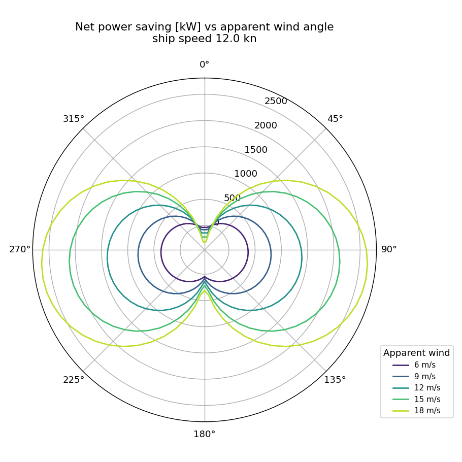
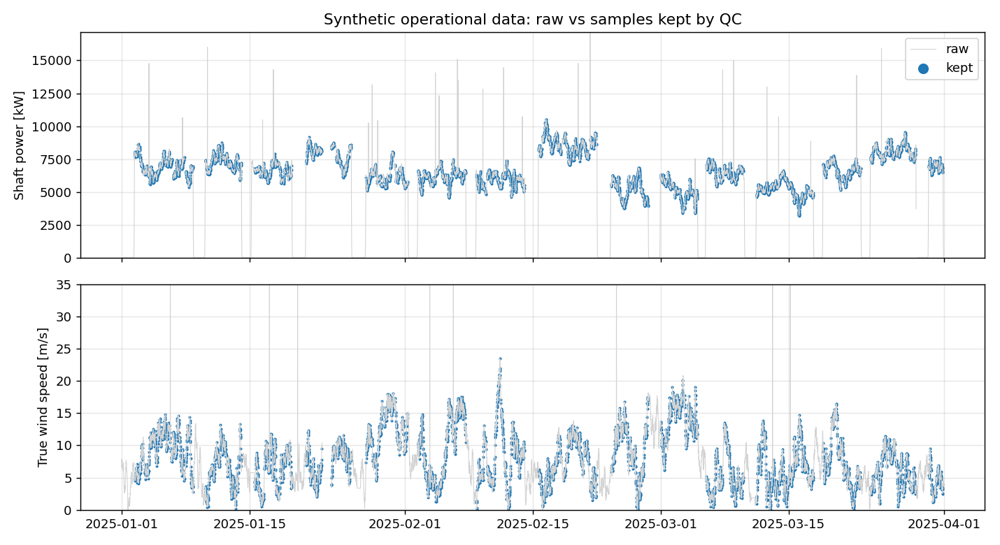
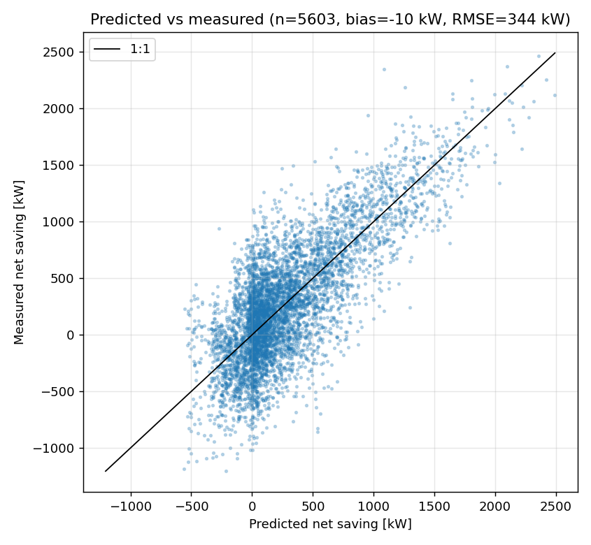
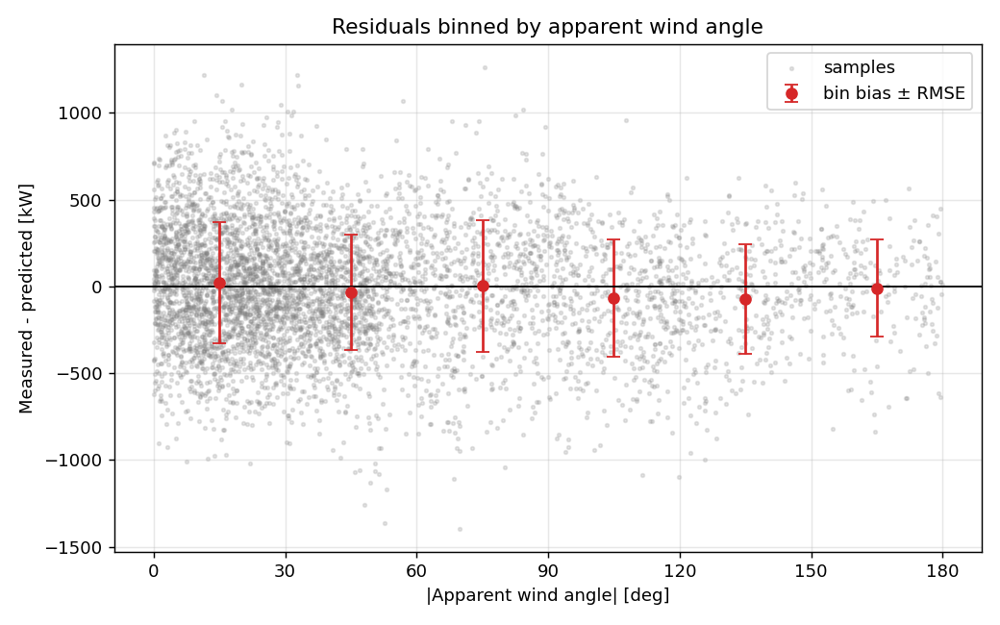
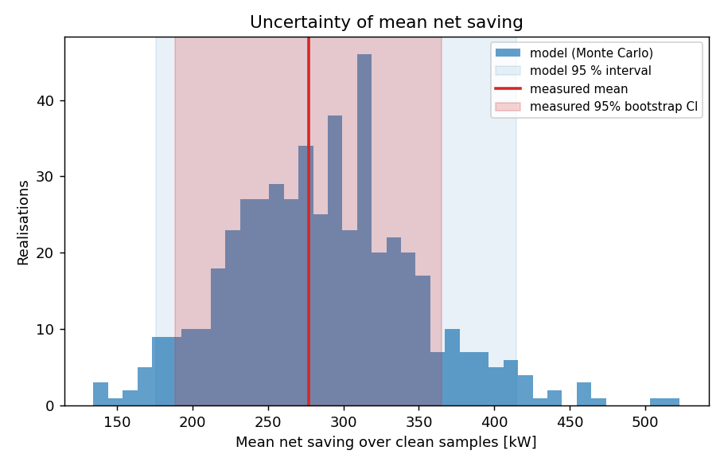

# rotor_sail_performance

Estimates the fuel and CO2 savings of Flettner rotor sails on a merchant ship
and checks the estimate against (synthetic) operational data.

> **This is a portfolio / learning project, not a design tool.** The rotor
> coefficient table shipped with it is an illustrative placeholder and all
> operational data are synthetic. Do not use the numbers for engineering or
> commercial decisions.

What it covers:

| Module | Purpose |
|---|---|
| `aero.py` | Wind triangle, spin-ratio control, Magnus lift/drag/power from a CL/CD/Cp lookup table, thrust along the heading for N rotors |
| `savings.py` | Net power saving, fuel and CO2 conversion, voyage integration, polar plots |
| `data_qc.py` | Reproducible synthetic 15-min operational data with realistic faults, and a logged cleaning pipeline |
| `verification.py` | Predicted vs "measured" savings, residuals binned by apparent wind angle, block bootstrap, Monte Carlo uncertainty, sanity checks |
| `examples/run_assessment.py` | End-to-end run producing figures, a Markdown performance report and Power BI-ready CSVs |

## Install

Python 3.10 or newer.

```bash
git clone <this repo>
cd rotor_sail_performance
python -m pip install -e ".[dev]"
pytest
python examples/run_assessment.py --out outputs
```

The example writes:

```
outputs/
  performance_report.md        method, assumptions, results with uncertainty, limitations
  figures/*.png                polars, predicted vs measured, residuals, uncertainty, QC
  powerbi/fact_operations.csv  one row per 15-min sample: sensors, QC flag, prediction, measurement, residual
  powerbi/summary_metrics.csv  metric, value, lower, upper, unit, method (long format)
  powerbi/metrics_by_awa_bin.csv
  powerbi/qc_log.csv
  powerbi/monte_carlo_samples.csv
  powerbi/polar.csv            long format: ship speed, AWS, AWA -> thrust, net saving
```

All CSVs are tidy (one observation per row, one variable per column, units in
column names, ISO 8601 timestamps in UTC) so they load directly into Power BI.
A copy of the report from the default run is in
[docs/example_report.md](docs/example_report.md).

## Theory

### Conventions

SI units throughout (speeds m/s, forces N, power W or kW where named).
Compass angles are degrees clockwise from north; the true wind direction is
where the wind comes **from**. The apparent wind angle (AWA) is measured from
the bow, positive when the wind comes from starboard, in (-180, 180].

### `aero.py`: wind triangle and rotor forces

**Wind triangle.** With true wind speed $V_{tw}$ from direction $\theta_{tw}$,
ship speed $V_s$ and heading $\psi$, in (east, north) components:

$$
\vec v_{app} = \underbrace{-V_{tw}(\sin\theta_{tw}, \cos\theta_{tw})}_{\text{air velocity}} - \underbrace{V_s(\sin\psi, \cos\psi)}_{\text{ship velocity}},\qquad
V_{aw} = |\vec v_{app}|,\qquad
\text{AWA} = \operatorname{wrap}\big(\operatorname{dir_{from}}(\vec v_{app}) - \psi\big)
$$

**Spin ratio and control.** $SR = \omega R / V_{aw}$. The controller targets a
fixed spin ratio but is limited by the motor speed:
$\omega = \min(SR_{target} V_{aw}/R,\ \omega_{max})$.

**Forces and power per rotor**, with $A = h\,d$ and $q = \tfrac12\rho_{air}V_{aw}^2$:

$$
L = q A\,C_L(SR),\qquad D = q A\,C_D(SR),\qquad P_{rotor} = q A V_{aw}\,C_P(SR)
$$

$C_L, C_D, C_P$ are linearly interpolated from a CSV table and held constant
outside it.

**Projection onto the ship.** With $\beta = |\text{AWA}|$ and the rotation
sense chosen so that lift points forwards:

$$
T = L\sin\beta - D\cos\beta,\qquad
F_{side} = -\operatorname{sign}(\text{AWA})\,(L\cos\beta + D\sin\beta)
$$

Beam wind gives $T = L$, head wind $T = -D$, following wind $T = +D$. For N
rotors everything is multiplied by N.

### `savings.py`: from thrust to fuel

$$
P_{net} = \frac{T\,V_s}{\eta_D} - P_{rotor},\qquad
\dot m_{fuel,saved} = P_{net}\cdot SFOC,\qquad
m_{CO_2} = m_{fuel}\cdot C_F
$$

At each time step the rotors are run at the target spin ratio or stopped
(SR = 0: no power, but still drag), whichever gives the larger $P_{net}$.
Percentage savings are relative to a calm-water speed-power curve
$P_{base} = P_{ref}(V_s/V_{ref})^n$.

`estimate_voyage` integrates these over a time series of speed, heading and
true wind. `savings_polar` / `plot_savings_polar` draw thrust or net saving
against AWA for several apparent wind speeds:



### `data_qc.py`: synthetic data and cleaning

The generator simulates 90 days at 15-min intervals of a ship shuttling
between two ports (sea legs, port stays, manoeuvring, course changes) in a
westerly wind with smooth AR(1) fluctuations. The "real" rotors in the
simulation are deliberately 8 % weaker in lift and 5 % stronger in drag
than the coefficient table, so verification has a known bias to look for.
Shaft power includes an AR(1) "weather" term (4 % std) that the calm-water
baseline cannot explain. Sensor noise, dropouts, a 1-day logger outage,
frozen sensors and spikes are injected. `numpy.random.default_rng(seed)`
drives everything, so a seed reproduces the dataset exactly. Hidden-truth
columns (`true_net_saving_kw`, `mode`, `injected_fault`) are kept for
testing and would not exist in real data.

Cleaning steps, each logged with counts and reasons:

1. **Missing values** in any sensor column.
2. **Range checks** against physical limits.
3. **Frozen sensors**: the same non-zero value for 8 or more samples (2 h).
   Exact zeros are exempt because a stopped engine or rotor reads zero.
4. **Outliers**: Hampel filter, $|x - \tilde x| > 4\,\max(1.4826\,\mathrm{MAD},\ 30\,\mathrm{kW},\ 3\%\,\tilde x)$
   over a 17-sample window.
5. **Steady state**: speed above 4 m/s, speed std below 0.25 m/s and
   cumulative heading change below 5 deg over a 5-sample window.



### `verification.py`: does the model match the data?

The "measured" saving is inferred, as in practice:
$P_{net,meas} = P_{base}(V_s) - P_{shaft} - P_{rotor}$.

* **Residuals** $r = $ measured $-$ predicted: bias, RMSE, MAE, $R^2$, overall
  and in 30 deg bins of |AWA|.
* **Bootstrap**: percentile CI of the mean. A moving-block bootstrap (block =
  1 day) is used because 15-min samples are strongly autocorrelated; an
  i.i.d. bootstrap would give over-confident intervals.
* **Monte Carlo**: systematic errors in wind speed (5 %), CL (10 %) and
  $\eta_D$ (+-0.03), all 1 sigma, are drawn once per realisation and
  propagated through the full model.
* **Sanity checks** flag non-finite or negative power, net savings larger
  than the baseline propulsion power, spin ratios beyond the coefficient
  table, and an overall saving above 30 % or below zero.





On the default run (seed 42) the measured mean saving is about 4 % of
baseline propulsion power. The bootstrap interval of the bias includes zero
even though the synthetic truth contains a 47 kW over-prediction: shaft power
measured against a calm-water baseline is too noisy to resolve a bias that
small from 90 days of data. The report says so explicitly.

## Assumptions

* **Coefficients**: placeholder CL/CD/Cp table, linear interpolation, clamped
  outside the table.
* **Aerodynamics**: uniform apparent wind over rotor height (no atmospheric
  boundary layer), no rotor-rotor or rotor-superstructure interaction, no
  ship motions, no current (speed through water = speed over ground),
  air density 1.225 kg/m^3.
* **Control**: fixed target spin ratio (3.0) capped by max rpm (180); rotors
  stop when that saves more. No optimisation of spin ratio.
* **Propulsion**: constant propulsive efficiency (0.70) unaffected by
  propeller unloading; one SFOC (175 g/kWh) for both the main engine saving
  and the rotor power, independent of engine load; CO2 factor 3.114 (HFO).
* **Side force** is ignored: no leeway, no rudder drag.
* **Baseline**: calm-water power law $P \propto V^3$ referenced to 7000 kW at
  12 kn (an illustrative mid-size bulk carrier, not a specific ship).
* **Uncertainty**: Monte Carlo input errors are independent, normally
  distributed and systematic over the whole dataset.

## Limitations

* The placeholder coefficients make every absolute number illustrative.
* Ignoring rotor-rotor interaction overestimates thrust when rotors are
  close together and one sits in the other's wake.
* Ignoring side-force effects (leeway, rudder) overestimates net savings,
  most in close-hauled conditions.
* Synthetic data verify the pipeline, not the physics.
* The "measured" saving depends entirely on the baseline speed-power curve;
  any baseline error goes straight into the bias.
* Voyage totals cover only the samples supplied (here: steady sailing after
  QC); they are not annualised.

## Replacing the coefficient table

`src/rotor_sail_performance/data/rotor_coefficients_illustrative.csv` is
**not experimental data**. To use real data, create a CSV with columns
`spin_ratio, cl, cd, cp` (lines starting with `#` are comments; cite your
source there) and pass it in:

```python
from rotor_sail_performance import RotorCoefficients
coeffs = RotorCoefficients.from_csv("my_rotor_data.csv")
```

or `python examples/run_assessment.py --coefficients my_rotor_data.csv`.

Make sure the reference area and power definition match: this package uses
$A = h\,d$ and $C_P = P / (\tfrac12\rho A V^3)$. Places to look for published
coefficients (check the end-plate geometry, aspect ratio and Reynolds number
match your case):

* Reid, E. G. (1924). *Tests of rotating cylinders.* NACA Technical Note 209.
* Thom, A. (1934). *Effects of discs on the air forces on a rotating
  cylinder.* Aeronautical Research Council R&M 1623.
* Badalamenti, C. and Prince, S. A. (2008). *The effects of endplates on a
  rotating cylinder in crossflow.* AIAA paper 2008-7063.
* Bergeson, L. and Greenwald, C. K. (1985). *Sail assist developments
  1979-1985.* Journal of Wind Engineering and Industrial Aerodynamics, 19.
* De Marco, A. et al. (2016). *Flettner rotor concept for marine
  applications: a systematic study.* International Journal of Rotating
  Machinery.
* Rotor manufacturers' published performance data and classification
  society type approvals.

Rotor power coefficients are rarely published in non-dimensional form;
they often have to be derived from motor power measurements.

## References

* IMO MEPC.1/Circ.896 (2021). *Guidance on treatment of innovative energy
  efficiency technologies for calculation and verification of the attained
  EEDI and EEXI.* Includes the method for wind-assisted propulsion.
* IMO MEPC.1/Circ.815 (2013). Earlier version of the same guidance.
* IMO guidelines on the method of calculation of the attained EEDI (e.g.
  MEPC.364(79)): source of the fuel carbon factors $C_F$.
* ITTC Recommended Procedure 7.5-04-01-01.1, *Preparation, conduct and
  analysis of speed/power trials*.
* ISO 19030 (2016). *Ships and marine technology: measurement of changes in
  hull and propeller performance.* Data filtering and reference conditions
  for in-service performance monitoring.
* Tillig, F. and Ringsberg, J. W. (2020). *Design, operation and analysis of
  wind-assisted cargo ships.* Ocean Engineering, 211.

## Licence

MIT, see [LICENSE](LICENSE).
